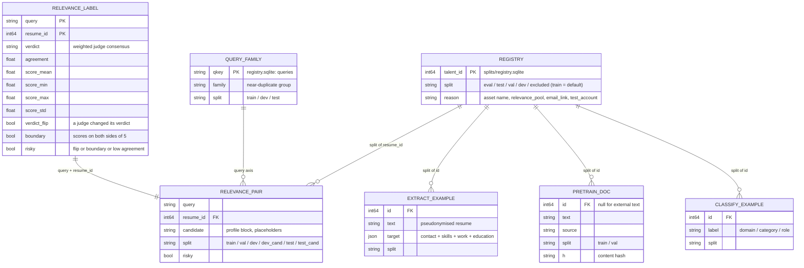

# Data model (ER diagram) — all sources and pipeline outputs

Snapshot of 2026-10-10 (Turn 45). Counts are exact unless marked. This page describes the data so we don't have to re-scan it; the T7 numbers are also in `training_data/t7_snapshot/`.

**The one key that joins everything:** `talent_id`. It has the same value under four names:
- `talent_id` in the T7 export and `resume_data`;
- `developer_id` in the work / education tables;
- `resume_id` (or `rid`) in the relevance data and curated sets;
- `id` in the GPT-5.x extraction JSONs.

Paths:
- **T7:** the copy on the pen drive, `/Volumes/New Volume/turing_candidate_dataset/`.
- **TD:** `/Volumes/New Volume/training_data/`.

## 1. Source data

```mermaid
erDiagram
    CANDIDATE ||--o{ WORK_EXPERIENCE : "talent_id = developer_id"
    CANDIDATE ||--o{ EDUCATION : "talent_id = developer_id"
    CANDIDATE ||--o| RESUME_DATA_OLD : "same talent_id (older export)"
    CANDIDATE ||--o{ RELEVANCE_JUDGMENT : "talent_id = resume_id"
    QUERY ||--o{ RELEVANCE_JUDGMENT : "query text"
    CANDIDATE ||--o| EXTRACTION_GOLD : "talent_id = id / resume_id"
    CANDIDATE ||--o| CURATED_ITEM : "talent_id = resume_id / talent_id"
    CANDIDATE ||--o| FRAUD_LABEL : "talent_id"
    CANDIDATE ||--o| JD_SCREENING : "talent_id (JOB-110870)"
    CANDIDATE ||--o| FIRED : "talent_id (not in main export)"
    SKILL_TAXONOMY ||--o{ SKILL_TAXONOMY : "parent / master / merge_into"
    SKILL_TAXONOMY }o--o{ CANDIDATE : "skills linked by name"

    CANDIDATE {
        int64 talent_id PK "5,555,173 unique"
        string resume_plain "5,539,424 non-empty, ~6B tokens"
        json parsed_resume_data "3,507,029 OpenAI parses"
        json work_experience "embedded list"
        json education "embedded list"
        string role "257 values"
        string domain "12% filled, 23 values"
        string subdomain "78 values"
        string country "222 values, India 50%"
        int full_time_experience_in_months "12% filled"
        string name_email_phone_urls "PII, pseudonymised"
        string salary_citizenship "sensitive, never used"
    }
    WORK_EXPERIENCE {
        int64 id PK "18,517,943 rows"
        int64 developer_id FK "5,219,842 people"
        string position
        string company
        int start_year "0 on 3%"
        int end_year "0 on 20% = current/unknown"
        string details
        string employment_type
        string seniority "891 raw values"
        int company_id "6% filled"
    }
    EDUCATION {
        int64 id PK "11,510,118 rows"
        int64 developer_id FK "5,903,692 people"
        string level "7 values"
        string degree
        string college
        int start_year
        int end_year "5.8% end < start"
        decimal cgpa
        int cgpa_scale "4 / 10 / 100 / 5"
        int university_id "7% filled"
    }
    RESUME_DATA_OLD {
        int64 talent_id PK "7,460,148 rows, 5,635,011 with text"
        string resume_plain
        json parsed_resume_data "3,451,678"
        string account_email "PII"
        string finger_print_id
    }
    QUERY {
        string query PK "164 normalised + up to ~115 from evaluation CSVs"
        string domain
    }
    RELEVANCE_JUDGMENT {
        string query FK
        int64 resume_id FK "256,185 candidates"
        string judge "12 judge columns + 12 gemini runs"
        string verdict "relevant / not_relevant"
        float score "0-10"
        string reason
        string failed "failed constraints"
        date judge_date
    }
    EXTRACTION_GOLD {
        int64 id PK "1,960 candidates"
        json taxonomy_extraction "GPT-5.x (5 model variants)"
        string Domain "curated domain label"
    }
    CURATED_ITEM {
        int64 resume_id_or_talent_id PK "296 rel / 250 ext / 481 fraud; 35-row set"
        string bucket
    }
    FRAUD_LABEL {
        int64 talent_id PK "969"
        string dataset
    }
    JD_SCREENING {
        int64 talent_id PK "1,165, one job"
        string final_recommendation "62 good / 83 review / 895 reject"
        string fraud_verdict
        string ai_interview_transcript "44, sensitive"
    }
    FIRED {
        int64 talent_id PK "10,923, not used"
    }
    SKILL_TAXONOMY {
        int skill_id PK "46,338 rows"
        string canonical_name
        string status "active / new / alias"
        string merge_into
        string parent_skill_corrected
        string category_corrected
        string primary_domain
        string confidence_band "High / Medium / Low"
    }
```

## 2. External data (no talent_id; pretraining text or external benchmark)

```mermaid
erDiagram
    HF_RESUME_JD_MATCH {
        string text "6,241 train + 1,759 test pairs"
        string label "Good / Potential / No Fit"
    }
    KAGGLE_RESUME {
        int ID PK "2,484 resumes"
        string Category "24 values"
    }
    JOB_TITLE_DES {
        string job_title "2,277 JDs, 15 titles"
        string description
    }
    DJINNI_JOBS {
        string id PK "141,897 JDs"
        string position
        string long_description
    }
    DJINNI_PROFILES {
        string id PK "210,250 profiles"
        string cv
    }
    RESUME_JOB_FIT {
        string resume "93,733 pairs, text only"
        string jd
    }
    KB_ENTITY {
        string kind "occupation / institution / company"
        string source "onet / esco / ror / sec / wikidata"
        string name
        list aliases
    }
    PUBLIC_TEXT {
        string text "Wikipedia 4.84M / FineWeb-Edu 2.9M / Cosmopedia 1.5M docs"
        string group "general (Wikipedia KB-entity articles -> knowledge)"
    }
    WDC_JOBPOSTING {
        string page_url PK "~4M postings (N-Quads)"
        string title
        string description
        string hiringOrganization
        string location
    }
```

## 3. Pipeline outputs (`artifacts/data/`)

## 4. Split rules

| Split | Who | Used for |
|---|---|---|
| eval | evaluation assets: extraction gold, curated sets, fraud ids, JOB-110870, human gold | evaluation only |
| test | ~20,000 relevance candidates drawn across all queries (each query keeps a share and both verdicts) | locked test |
| val | half of ~10,000 more relevance candidates + 0.5% of everyone else | early stopping, calibration, pretraining perplexity |
| dev | the other half of those ~10,000 candidates | decisions: ablations, baselines, budget sweeps |
| excluded | QA / test accounts (`@turing.com`, `+test` / `+qa`) | nothing |
| train | everyone else | all training |

- **One split per person:** a talent_id is in exactly one split for every task, and accounts sharing an e-mail share the split. `audit` fails the build otherwise.
- **Unstable labels stay in:** pairs whose score moved enough to flip the verdict are kept as soft targets and flagged `risky`. The eval reports `stable_*` metrics on the non-risky pairs next to the overall ones.

**Relevance pairs (Turn 47)** combine two axes: the query family (train / dev / test) and the candidate split above.
- **dev / test:** unseen query families.
- **val / dev_cand / test_cand:** held-out candidates on training-family queries.

The audits assert zero query-family overlap; see `data_pipeline/README.md`.

**Pretraining groups (Turn 51).** Every pretraining document has a `group`: resume / jobs / knowledge / general. Pack writes `packed/pretrain_<group>_{train,val}.bin`, and the trainer mixes the groups (`pack.pretrain_mix`). Which dataset goes where: `../data_for_training.md` §0.
